# VaaniDesk: Real-Time Multilingual Voice AI Receptionist

> An AI receptionist for Indian clinics and hospitals. It **answers phone calls and web chats** in **English, Hindi and Telugu**, books appointments and OPD tokens, sends patients to the right doctor, confirms on **WhatsApp, SMS or email**, and hands off to staff when needed. One server runs many clinics, each with its own staff logins and dashboard.


**Live demo:** [vaanidesk.onrender.com/demo](https://vaanidesk.onrender.com/demo) (free hosting: the first load can take about a minute while the server wakes up)

| Patients: chat or talk to the receptionist | Clinic staff: everything that needs attention |
|---|---|
| 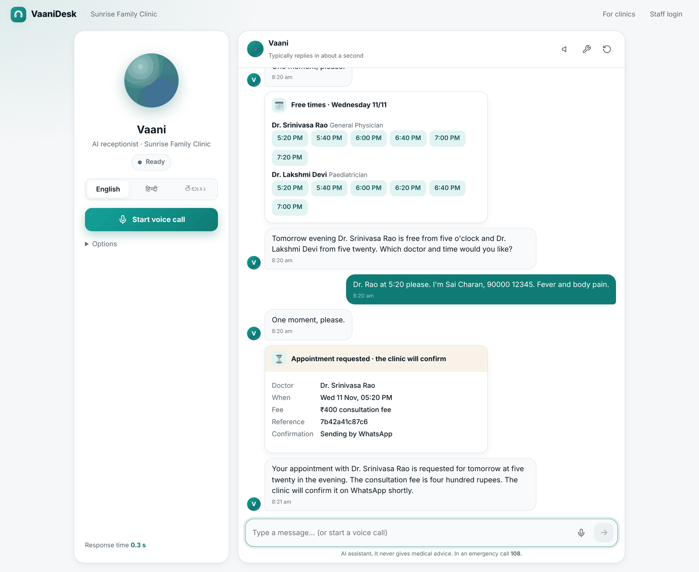 | 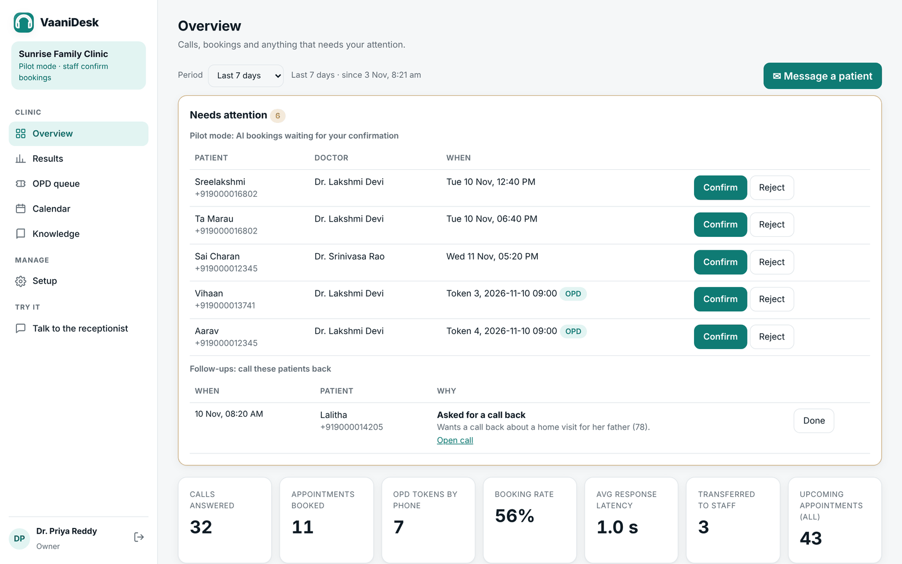 |

<sub>Screenshots are generated by [`scripts/screenshots.py`](scripts/screenshots.py) with mocked AI providers and made-up sample data (fake names and numbers). Latency figures in them are not real measurements; see [Tests and evals](#tests-and-evals) for measured numbers.</sub>

---

## The problem

Small clinics, salons and restaurants miss many calls when the front desk is busy or closed. Every missed call can be a lost customer. A full-time receptionist is expensive, and "press 1 for…" IVR menus frustrate callers and rarely support Indian languages.

## The solution

VaaniDesk picks up the call and talks like a human receptionist:

```
Caller (Telugu): "రేపు సాయంత్రం డాక్టర్ అపాయింట్‌మెంట్ కావాలి"   (I need a doctor's appointment tomorrow evening)
VaaniDesk:        checks calendar → "డాక్టర్ రావు గారు 5:00 లేదా 5:20 కి ఖాళీగా ఉన్నారు. ఏది సరిపోతుంది?"
Caller:           "5 గంటలకి. నా పేరు సాయి."
VaaniDesk:        books slot → sends SMS/WhatsApp confirmation → logs the call for the owner
```

## Product tour

Every page below is part of the app today. Staff pages sit behind a login and only ever show the logged-in clinic's data.

### For patients

| Chat or voice, with the receptionist's actions as cards | OPD token by phone or chat | On a phone |
|---|---|---|
|  | 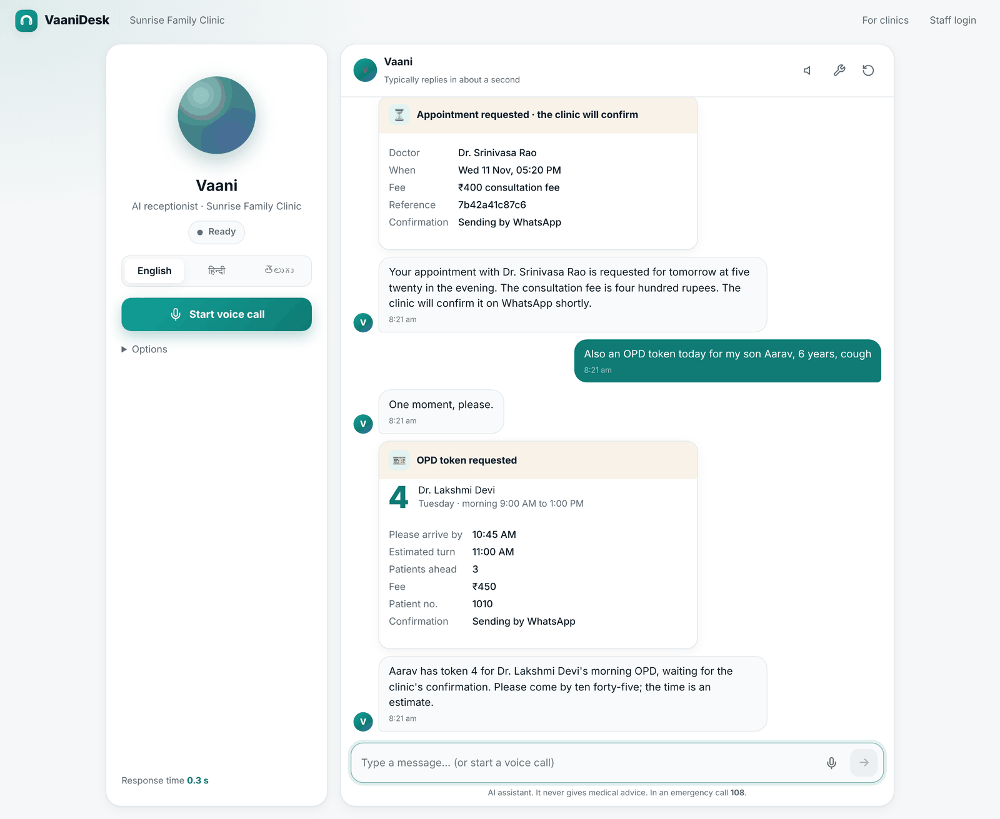 | 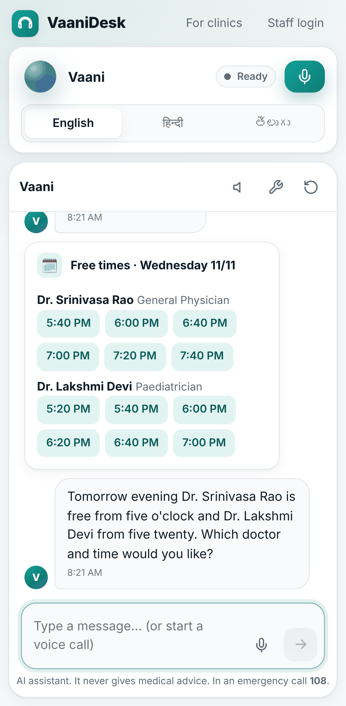 |

**Talk to the receptionist** (`/demo?clinic=<id>`) works as a chatbot or as a voice call in the same conversation. Free time slots are tappable, bookings and tokens appear as tickets, and an answer from the clinic's documents shows its source. Logged-in staff who open it test their own clinic's receptionist.

### For the clinic

**Overview** (`/dashboard`) shows everything that needs a person: AI bookings waiting for confirmation (pilot mode), patients to call back, and setup problems. It also has the period's numbers, every call with its transcript, and upcoming appointments.

| Call transcript with tool calls and per-turn latency | Messages to patients, with delivery status |
|---|---|
| 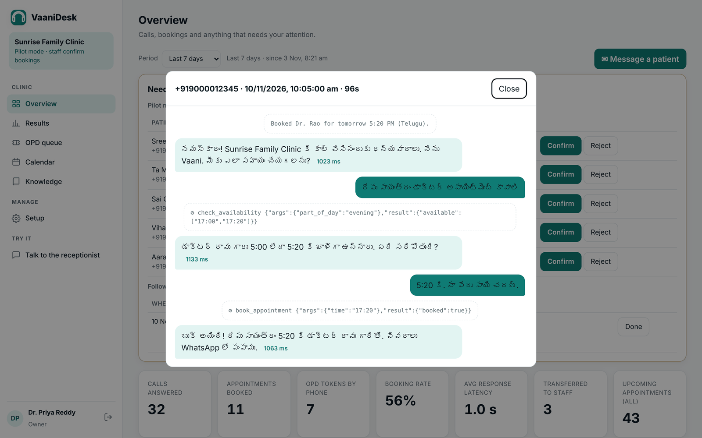 | 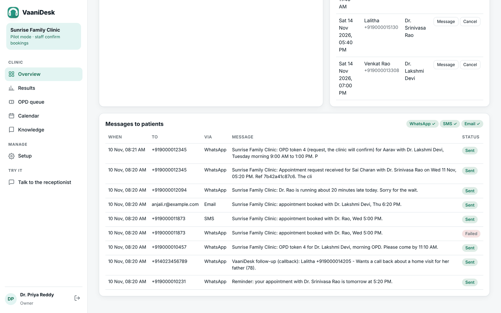 |

**Message a patient:** staff send WhatsApp (SMS if WhatsApp fails) and/or email from the dashboard, with quick replies, or with one click from an appointment.

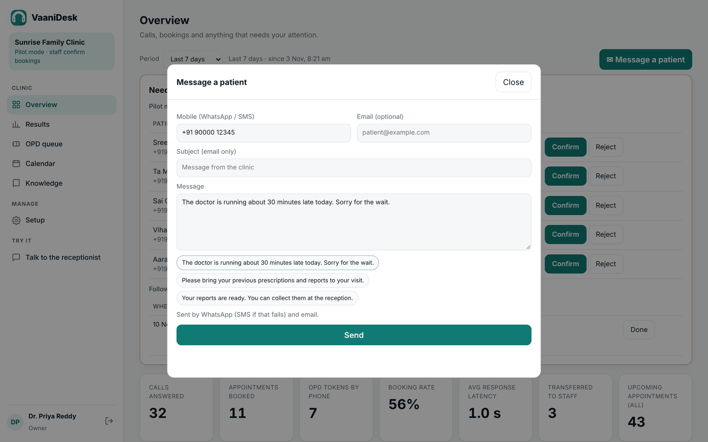

| OPD queue | Calendar |
|---|---|
| 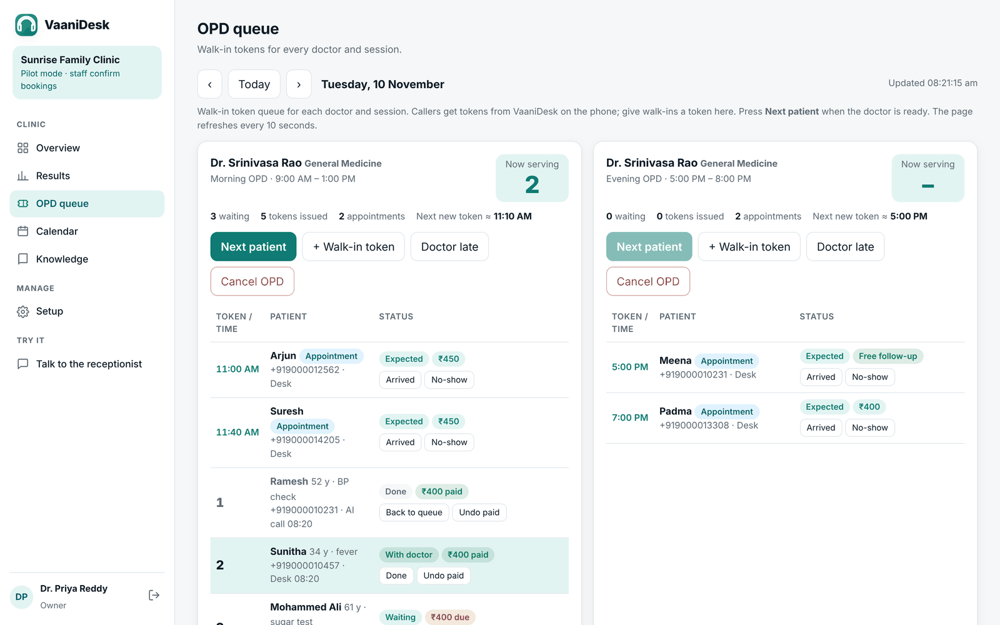 | 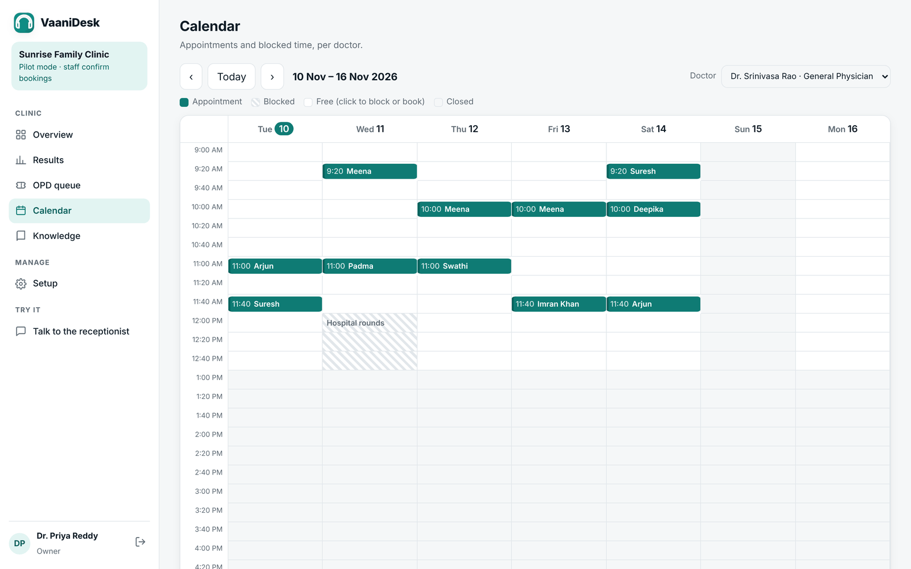 |

- **OPD queue** (`/opd`): each doctor's morning and evening session with walk-in tokens *and* fixed-time appointments. Buttons: **Next patient**, walk-in token, doctor running late, cancel OPD, confirm/reject AI tokens, mark paid, and **Arrived / Seen / No-show** for appointments.
- **Calendar** (`/calendar`): week view per doctor. Click a free slot to block time or book, plus a private link to subscribe in Google, Apple or Outlook calendar.

| Results (for the clinic owner) | Knowledge (documents the AI answers from) |
|---|---|
| 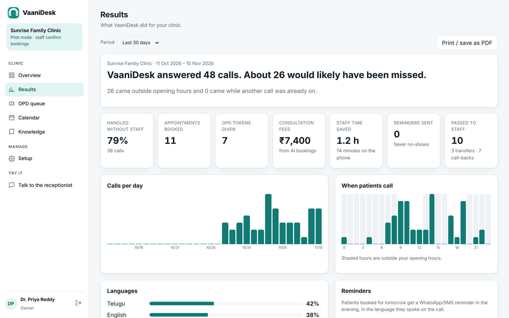 | 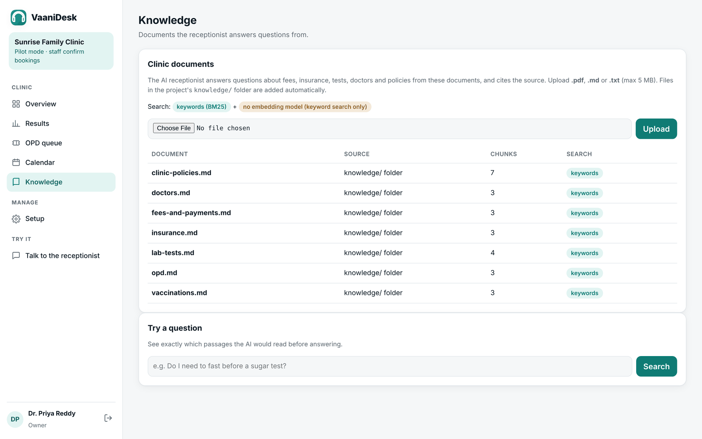 |

- **Results** (`/report`, printable): calls answered, how many the desk **would have missed** (after hours or while already on a call), share handled without staff, bookings, tokens, consultation fees from AI bookings, staff time saved, languages and busiest hours.
- **Knowledge** (`/knowledge`): upload PDFs or notes. **Try a question** shows exactly which passages the AI would read before answering.

| Setup (owner) | Clinics (platform admin) |
|---|---|
| 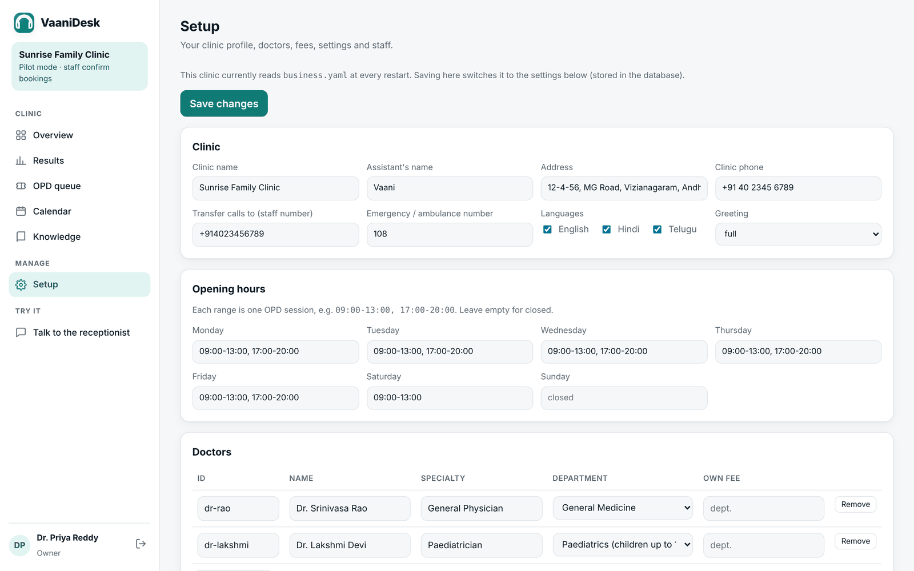 | 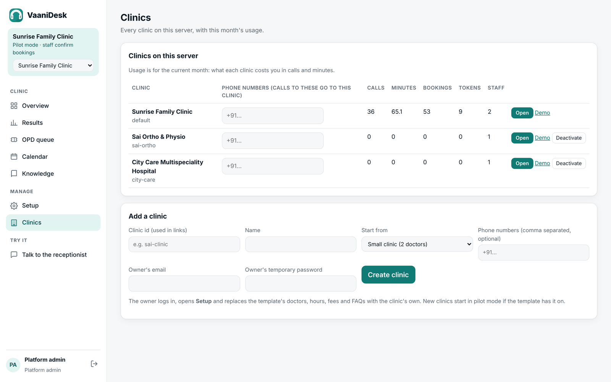 |

- **Setup** (`/setup`): clinic profile, opening hours (each range is one OPD session), doctors, departments and routing, fees, FAQ, pilot mode, patient messages (WhatsApp → SMS order, email), reminders, OPD rules, staff accounts and the activity log.
- **Clinics** (`/admin`): every clinic on the server with this month's calls, minutes, bookings, tokens and staff, phone-number routing, and new clinics from a clinic or hospital template.

| Self-service sign-up | Staff login |
|---|---|
| 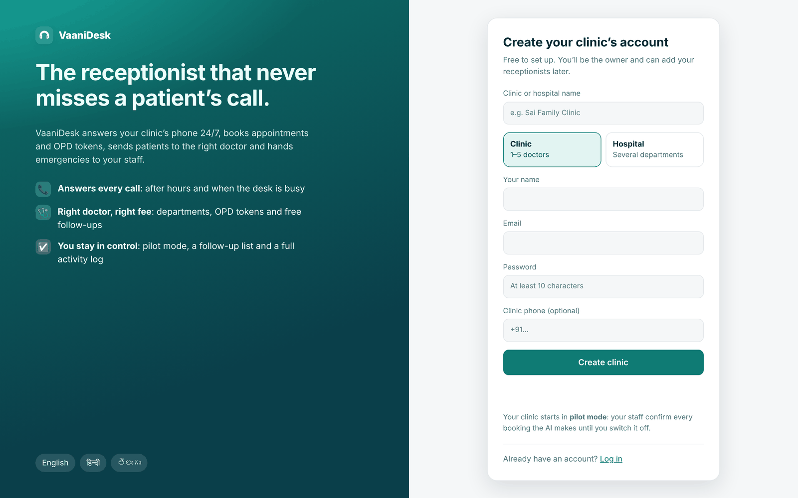 | 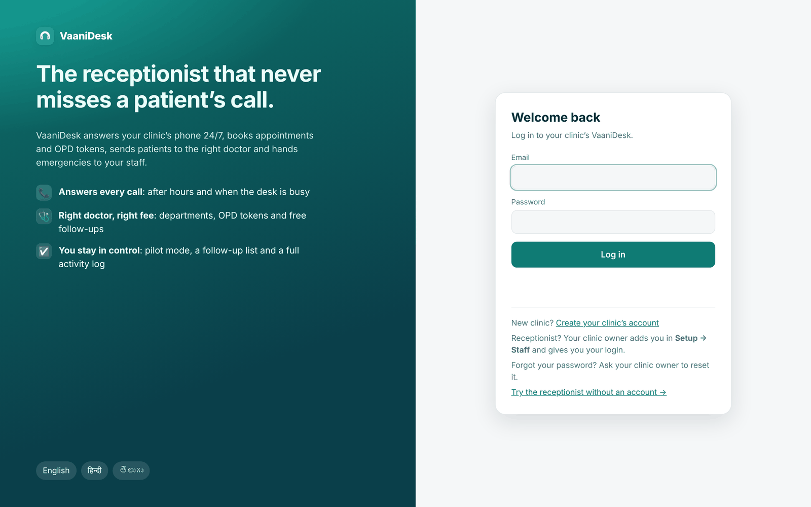 |

A clinic signs itself up on `/signup` (starting in pilot mode) and adds its receptionists. Sign-up can be closed or made invite-only.

## Features

- 📞 **Real phone calls** through Twilio Media Streams (bidirectional 8 kHz μ-law audio over WebSocket)
- 🌐 **Browser voice demo** that anyone (including recruiters) can try with no phone
- 🗣️ **Multilingual:** English, Hindi and Telugu, including **mid-call language switching** and Telugu/Hindi-English code-mixing
- ⚡ **Streaming pipeline:** STT → LLM → TTS, each streamed, so speech starts as soon as the first sentence is ready
- ✋ **Barge-in:** the caller can interrupt and the agent stops and listens. It reacts to recognised words, not to coughs or its own echo, and if an interruption brings no words it finishes the answer instead of going silent
- 🛠️ **Agentic tool use:** check availability, book, find, reschedule or cancel appointments, transfer to a human, end the call
- 📚 **RAG over clinic documents:** answers fees, insurance, test-preparation and policy questions from the clinic's own PDFs and notes, using hybrid search (BM25 + embeddings, pgvector on Postgres), with the source shown on the dashboard
- 🔒 **Guardrails in the tools, not just the prompt:** callers can only see or change their own bookings (matched by phone), invalid numbers and placeholder names are rejected, and a change of mind moves the booking instead of double-booking
- 🎫 **OPD token queue:** callers take a walk-in **OPD token** by phone ("token 7 for Dr. Rao's evening OPD, please come by 5:45"), ask "which number is going on?" or "how long will I wait?", and cancel tokens. Reception runs the live queue on the **OPD page**: walk-in tokens, **Next patient**, missed turns, "doctor running late" (shifts every estimate) and cancelled sessions. Fixed-time **appointments appear in the same queue** (Arrived / Seen / No-show). Patients get a reusable patient number on their first token.
- 🩺 **Right doctor for new patients:** callers describe the problem ("knee pain", "my son has a cough") and VaaniDesk picks the **department and doctor**, applying age rules (children → paediatrics) and gender rules (pregnancy → gynaecology), and flags danger signs for 108. It never diagnoses. Works for a 2-doctor clinic ([`config/business.yaml`](config/business.yaml)) or a multispeciality hospital ([`config/hospital.yaml`](config/hospital.yaml), 8 departments).
- 💰 **Consultation fees and free follow-ups:** fees per department or doctor; a repeat visit to the same department within N days is a follow-up (free or reduced). It's tracked per patient across tokens and appointments, told to the caller, and shown on the OPD page with **Mark paid**.
- 💬 **Chat or talk:** the public page (`/demo?clinic=<id>`) works as a chatbot (type) or a voice call (talk) in the same conversation, with suggestion chips, a typing indicator, and the receptionist's actions shown as cards: free time slots you can tap, booking confirmations, OPD token tickets, the recommended doctor, and the document an answer came from.
- 🔑 **Self-service sign-up:** a clinic creates its account on `/signup` (starting in pilot mode), then adds its receptionists; staff log in on `/login`. Wrong-password attempts and sign-up spam are rate-limited. `SIGNUP_ENABLED` / `SIGNUP_CODE` close sign-up or make it invite-only.
- 🏥 **One server, many clinics:** every call, patient, booking, token, document and staff account belongs to a clinic, enforced in one place in the database layer. Each clinic has its own phone numbers, demo link (`/demo?clinic=<id>`) and calendar feed. Staff log in with their own accounts (**owner** or **receptionist**), every action is in an activity log, and owners edit doctors, hours, departments, fees, FAQs and settings on a **Setup** page instead of YAML. A platform **Clinics** page creates clinics from a clinic or hospital template and shows each clinic's monthly calls, minutes and bookings.
- 🇮🇳 **Indian phone numbers:** an **Exotel** Voicebot (AgentStream) integration, so clinics can forward their existing number to VaaniDesk on busy or no answer (see [GO_LIVE Step 4](docs/GO_LIVE.md)).
- 📈 **Results report for clinic owners** (`/report`, printable): calls answered, how many the front desk **would have missed** (after hours, or while already on a call), share handled without staff, appointments and tokens booked, consultation fees from AI bookings, staff time saved, language mix and busiest hours.
- 📲 **Patient messages on WhatsApp, SMS and email:** every booking, token, change and cancellation sends a confirmation (WhatsApp first, SMS if that fails, plus email when the patient gives one). Staff can message any patient from the dashboard ("the doctor is running late"), and every message is logged with its delivery status.
- ⏰ **Day-before reminders** on WhatsApp/SMS/email for appointments and OPD tokens, in the language the patient spoke, sent once in the evening (time set per clinic) to reduce no-shows.
- 🛟 **Built for real clinics:** **pilot mode** (AI bookings wait for staff to confirm), a **Needs attention** list on the dashboard (AI outages, calls that ended mid-booking, callback requests, with SMS alerts to staff), a spoken apology and handover when an AI provider fails, a database rule against double bookings, an "I'm an AI assistant" notice, automatic transcript deletion after N days, and backup/restore scripts with a restore drill. See [docs/OPERATIONS.md](docs/OPERATIONS.md).
- 📅 **Clinic calendar with zero setup:** week view per doctor where staff block time (meetings, leave) and book walk-ins, plus a private **subscribe link** that shows bookings in Google, Apple or Outlook calendar on the owner's phone. Optional two-way **Google Calendar** sync.
- 📊 **Clinic dashboard:** Needs attention (pilot confirmations, call-backs, setup warnings), calls with transcripts and AI summaries, booking rate, per-turn latency, language mix, upcoming appointments and the patient message log
- 🧪 **Tested:** 184 automated tests (93% line coverage), including protocol tests against mock Sarvam, Deepgram and OpenAI servers
- 🎯 **LLM evals:** multilingual conversation scenarios scored for tool use, outcome, reply language, brevity and safety
- 🔐 **Production touches:** Twilio webhook signature validation, dashboard auth, demo access code, concurrency limits, call watchdog, Docker and CI

## Architecture

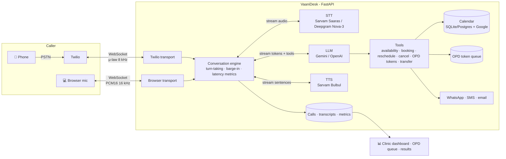

**One caller turn, step by step**

1. Caller audio streams to STT continuously. VAD events detect when the caller starts and stops speaking.
2. On end-of-turn (silence plus a 350 ms grace period), the transcript goes to the LLM with the conversation history and tool schemas.
3. LLM tokens stream into a **sentence chunker**. Each finished sentence goes straight to streaming TTS, so the agent starts speaking before the LLM has finished.
4. When the LLM calls a tool (for example `check_availability`), VaaniDesk runs it, feeds the result back and keeps streaming.
5. The TTS voice language is chosen from the **script of each reply** (Telugu, Devanagari or Latin), so language switches are seamless.
6. If the caller's words are recognised while the agent is talking, the response task is cancelled and the phone's audio buffer is cleared (`clear` event). The model is told its reply was interrupted. Tool results are recorded first, so a booking made just before an interruption is never forgotten.
7. Latency from end of the caller's speech to the first audio byte is measured on every turn and shown on the dashboard.

More detail: [docs/architecture.md](docs/architecture.md).

## Tech stack

| Layer | Choice | Why |
|---|---|---|
| API / realtime | FastAPI, WebSockets, asyncio | One async process handles webhooks, media streams and the dashboard |
| Telephony | Exotel Voicebot (India), Twilio Media Streams | Real phone numbers and bidirectional audio |
| Patient messages | Meta WhatsApp Cloud API, Twilio WhatsApp/SMS, any SMTP server | WhatsApp first, SMS fallback, email copy, every message logged |
| Speech-to-text | Sarvam Saaras v4 (default), Deepgram Nova-3 | Sarvam auto-detects 22 Indian languages; Deepgram is a low-latency alternative |
| LLM | Any OpenAI-compatible API: Gemini (`gemini-3.5-flash-lite`, used in the evals), OpenAI, Groq | Fast streaming with reliable tool calling; switch with `OPENAI_BASE_URL` / `OPENAI_MODEL` |
| Text-to-speech | Sarvam Bulbul v3 (streaming WebSocket) | Natural Indian English, Hindi and Telugu voices |
| Data | SQLAlchemy 2.0 async, SQLite or PostgreSQL | Zero setup locally, Postgres in production |
| Quality | Pytest (184 tests), mock provider servers, LLM eval harness, Playwright screenshots, Ruff, GitHub Actions | |
| Deploy | Docker, docker-compose (app + Postgres) | |

## Quickstart (browser demo, about 5 minutes)

```bash
git clone https://github.com/Charan7221/vaanidesk.git && cd vaanidesk
python -m venv .venv && source .venv/bin/activate      # Windows: .venv\Scripts\activate
pip install -r requirements-dev.txt
cp .env.example .env        # add an LLM key (Gemini or OpenAI) and SARVAM_API_KEY
python -m scripts.check_setup   # checks every key with a real request
uvicorn app.main:app --reload
```

Open **http://localhost:8000/demo** and type, or click **Start voice call** and speak. Staff pages start at **http://localhost:8000/login**: create a clinic on `/signup`, or log in as the platform admin with `ADMIN_USER` / `ADMIN_PASSWORD` from `.env`.

> Without API keys the server still starts (dashboard, docs and tests work). `/health` lists which keys are missing.

### Get API keys

| Service | Where | Free tier |
|---|---|---|
| Google Gemini (recommended to start) | aistudio.google.com → Get API key | Free tier |
| OpenAI (alternative) | platform.openai.com → API keys | Pay-as-you-go |
| Sarvam AI | dashboard.sarvam.ai | Free credits on signup |
| Deepgram (optional) | console.deepgram.com | Free credits on signup |
| Exotel (Indian numbers) | exotel.com | Paid; see [GO_LIVE Step 4](docs/GO_LIVE.md) |
| Twilio (optional) | twilio.com/try-twilio | Trial credit; a phone number costs about $1–2/month |
| WhatsApp / email (optional) | Meta WhatsApp Cloud API; any SMTP (e.g. a Gmail app password) | See [GO_LIVE Step 5](docs/GO_LIVE.md) |

## Real phone calls (Twilio)

1. Expose your server over HTTPS. Locally: `ngrok http 8000`, then set `PUBLIC_BASE_URL=https://<id>.ngrok-free.app` in `.env`.
2. Buy a voice-capable number in the Twilio Console and add `TWILIO_ACCOUNT_SID`, `TWILIO_AUTH_TOKEN` and `TWILIO_PHONE_NUMBER` to `.env`.
3. In the Twilio Console, go to **Phone Numbers → your number → Voice → "A call comes in"** and choose **Webhook**, `POST`, `https://<your-domain>/twilio/voice`.
4. Call the number.

Trial accounts can only call and text **verified** numbers, and calls start with a short Twilio trial message. Upgrade the account to remove both. For an Indian caller experience, buy a number your audience can dial cheaply, or use Twilio's WhatsApp sandbox for confirmations.

## Adapting it to any business

Clinic owners change everything on the **Setup** page: profile, hours, doctors, departments, fees, FAQ, messages and staff. New clinics start from [`config/business.yaml`](config/business.yaml) (2-doctor clinic) or [`config/hospital.yaml`](config/hospital.yaml) (8-department hospital). The same engine works for a salon, restaurant or service centre with a different profile.

## Tests and evals

```bash
pytest -q                       # 184 tests, offline, about 40 s
python -m evals.run_evals       # multilingual LLM conversation evals (needs OPENAI_API_KEY)
python -m evals.run_evals -k telugu --repeat 3
python -m scripts.screenshots   # regenerate docs/screenshots (needs: pip install playwright && playwright install chromium)
```

The eval harness runs scripted callers ([`evals/scenarios.yaml`](evals/scenarios.yaml)) through the **real** conversation engine, LLM and tools, with audio replaced by text. It covers English, Hindi and Telugu bookings, Telugu-English code-mixing, FAQ, closed days, emergency transfer, refusing medical advice and cancellation. Each run is scored on tools called, outcome, reply script, reply length and banned content, and results go to `evals/results.json`.

**Results** (`gemini-3.5-flash-lite` via the OpenAI-compatible API, free tier, 18 Oct 2026):

| Scenarios | Pass rate | Median time to first spoken word | p90 | Median full turn (LLM + tools) |
|---|---|---|---|---|
| 10 (en / hi / te, code-mixing, emergency, safety, cancel) | **10 / 10** | **1.0 s** | 1.3 s | 1.9 s |

"Time to first spoken word" is what the caller waits for: when a tool is needed, VaaniDesk speaks a short filler ("One moment, please." / "जी, एक पल रुकिए।" / "ఒక్క క్షణం అండీ.") the moment the model asks for the tool, then answers when the tool returns. This cut the wait from about 1.9 s to 1.0 s. For Gemini 3 models VaaniDesk sets the model's thinking to `minimal` by default (`LLM_REASONING_EFFORT`), because on live calls default thinking added several seconds to some replies. Live calls add speech-to-text end-of-turn detection and the first chunk of text-to-speech on top of these numbers.

### OPD tokens (walk-in queue)

Many Indian clinics don't run on fixed appointment times: patients take a **token** for a doctor's OPD session and are seen in token order. VaaniDesk supports both side by side.

| Caller says | What happens |
|---|---|
| "I want a token for Dr. Rao today" | `get_opd_token` issues the next number in that doctor's current or next session, registers the patient (patient number reused on later visits), estimates the turn time and sends an SMS |
| "Which number is going on? How long will I wait?" | `check_opd_status` gives the caller's position, the token being seen now and an estimated time, including any delay staff entered |
| "Is Dr. Lakshmi coming today?" | the same tool reports cancelled or late sessions with the staff's note |
| "What ID do I need for registration?" | answered from [`knowledge/opd.md`](knowledge/opd.md) through RAG, because static facts belong in documents and live queue data belongs in tools |

Guardrails live in the tools: tokens only for today and the next `advance_days`, phone tokens stop `stop_before_end_minutes` before a session ends (the desk can still give walk-in tokens), sessions have a cap, a patient asking twice gets the same token, and callers only ever see their own token (other patients' names are never returned). Token numbers are protected by a database unique constraint, so two simultaneous calls can't get the same number. Settings live under `opd:` in [`config/business.yaml`](config/business.yaml).

The reception screen at **/opd** shows every doctor's session with "Now serving", the waiting list and buttons for **Next patient**, **+ Walk-in token**, **Doctor late** and **Cancel OPD**. It refreshes every 10 seconds.

### Departments, routing and fees

Each department in the config has a `treats` list in plain English, optional `age_min` / `age_max` / `gender` rules, and fees:

```yaml
departments:
  - id: orthopaedics
    name: "Orthopaedics"
    consultation_fee: 600
    follow_up_days: 7          # a repeat visit within 7 days...
    follow_up_fee: 0           # ...is free
    treats: [fracture, joint pain, knee pain, back pain, sprain, arthritis]
providers:
  - {id: dr-ravi, name: "Dr. Ravi Teja", specialty: "Orthopaedic Surgeon", department: orthopaedics}
```

When a caller describes a problem without naming a doctor, the agent rewrites it in simple English and calls `find_doctor`. The most specific match wins ("child fever" beats "fever"), departments for children or women win ties, and patients who don't fit an age or gender rule fall back to paediatrics (children) or the default department. Danger words such as "chest pain" or "unconscious" are flagged so the agent sends the caller to 108 instead.

Every token and appointment records the **fee type**: `new` (full fee) or `follow_up` when the same patient (name + phone) paid for a visit in the same department within the window. Family members sharing a phone are separate patients. Existing databases get the new columns automatically on startup.

### Knowledge base (RAG)

Callers ask things a booking system can't answer: *"Do I need to fast before my sugar test?"*, *"Do you take cashless insurance?"*. VaaniDesk answers these from the clinic's own documents:

1. **Ingest:** files in [`knowledge/`](knowledge/) (and PDFs/notes uploaded on the dashboard's **Knowledge** page) are split into heading-sized chunks. Each chunk keeps its heading path, which becomes its citation (`lab-tests.md › Preparing for a test`). Unchanged files are never re-embedded.
2. **Retrieve:** the agent calls `search_clinic_knowledge` with the question rewritten in English. Search fuses **BM25 keywords** and **embedding similarity** with Reciprocal Rank Fusion. On Postgres the vector search runs in SQL with **pgvector**; locally it runs in NumPy. If embeddings are unavailable (no key, quota), it falls back to keywords, so answers never stop.
3. **Answer:** the agent answers only from the returned passages, in the caller's language, and says it isn't sure (offering staff) when the documents don't cover the question. Passages are treated as data, not instructions.
4. **Cite:** every lookup appears in the call transcript on the dashboard with its sources.

```bash
python -m evals.retrieval        # hit@1 / hit@3 / MRR for keyword vs vector vs hybrid, per language
```

**Results** (24 questions, `gemini-embedding-001`, 18 Oct 2026). Hit@1 = the right passage ranked first:

| Search | English | English, paraphrased | Hindi | Telugu | All hit@1 | All hit@3 | MRR |
|---|---|---|---|---|---|---|---|
| Keywords (BM25) | 100% | 57% | 0% | 0% | 54% | 58% | 0.56 |
| Vectors | 89% | 71% | 100% | 100% | 88% | 100% | 0.94 |
| **Hybrid (used)** | **100%** | 57% | **100%** | **100%** | **88%** | **100%** | **0.94** |

What this shows:

- **Keywords alone fail on other languages:** 0% for Hindi and Telugu questions, because they share no words with the English documents.
- **Multilingual embeddings fix that:** 100% for Hindi and Telugu, even before the agent translates the question.
- **The hybrid keeps keyword precision on exact English terms** (100%) while matching vectors overall.
- **The answer is always in the passages the agent reads:** hit@3 is 100% on every question. The three that miss rank 1 are paraphrases ("kids' doctor", "come to my house") whose answer is ranked second.

### Simulated callers + LLM judge

```bash
python -m evals.simulate        # LLM-played callers talk to the real agent; a judge LLM scores each call
```

Scripted evals only test what you thought of. [`evals/simulate.py`](evals/simulate.py) goes further: an LLM **plays a caller** from [`evals/personas.yaml`](evals/personas.yaml) (an impatient engineer, a Hindi caller who changes her mind, a Telugu-English-mixing mother, an elderly caller who gives a wrong number, a prompt-injection attacker, a parent pressing for medicine doses, a Telugu emergency, a Sunday-only customer, a cancellation) and holds a free-form conversation with the **real agent, tools and database**. Each call is then scored two ways:

- **Hard checks** on the database and tool log: which bookings exist afterwards (day, doctor, time, phone), which tools ran, and phrases the agent must never say (other patients' names, drug doses).
- **An LLM judge** with a rubric: task completion, correctness against tool results, language consistency, brevity and safety (1-5 each).

A call passes only if every hard check passes, the judge confirms success, and no score is below 3. The full transcripts and scores are written to [`evals/sim_report.md`](evals/sim_report.md). The judge can use a different model from the agent (`--judge-model`) to avoid a model grading itself, and requests are paced (`--rpm`) to fit free-tier rate limits.

<!-- SIM_RESULTS -->

## Deployment

**Step-by-step guide:** [docs/GO_LIVE.md](docs/GO_LIVE.md) covers Google Calendar sync, a one-click Render deploy (`render.yaml`) and a Twilio phone number.

```bash
docker compose up --build       # app + Postgres on :8000
```

Any Docker host with WebSocket support works (Render, Railway, Fly.io, AWS ECS or a VM). Set the environment variables from `.env.example`, point `PUBLIC_BASE_URL` at the public HTTPS URL, and update the Twilio webhook. Set `DEMO_ACCESS_CODE` before sharing a public demo link so strangers can't spend your API credits.

## Project structure

```
app/
  main.py                 FastAPI app, routes, startup
  config.py               settings (.env)
  business.py             business profile, opening hours → slots
  db.py                   SQLAlchemy models (calls, turns, appointments)
  audio.py                μ-law codec, resampling, WAV parsing (numpy)
  pipeline/
    session.py            real-time conversation engine (turn-taking, barge-in, tools, metrics)
    text.py               streaming sentence chunker, script-based language detection
    prompts.py            system prompt and multilingual greetings
  providers/              STT / LLM / TTS behind small interfaces (swappable)
  tools/                  calendar, agent tools, Twilio REST client
  transports/             Twilio media stream and browser WebSocket
  tools/opd.py            OPD token queue: tokens, patient numbers, live position, waiting time and fees
  tools/routing.py        problem -> department and doctor (age/gender rules, emergency flags)
scripts/backup.py         database export / restore / restore drill (SQLite and Postgres)
scripts/check_setup.py    tests every API key with a real request
scripts/screenshots.py    regenerates the README screenshots (sample clinic, mocked AI)
  auth.py                 staff logins, roles, signed session cookie, clinic selection, audit log
  state.py                one Tenant (profile, calendar, tools, knowledge) per clinic
  api/accounts.py         login, staff accounts, Setup page, platform clinic admin and usage
  transports/exotel.py    Exotel Voicebot (Indian numbers)
  api/report.py           results report (missed calls saved, bookings, fees, time saved)
  messaging.py            WhatsApp (Meta/Twilio), SMS and email with fallback + message log
  tools/reminders.py      day-before WhatsApp/SMS/email reminders
  background.py           tracked background tasks; database writes that survive cancellation
  api/dashboard.py        owner dashboard API
  api/opd.py              OPD reception screen API (walk-ins, next patient, delays)
static/                   chat/voice demo (AudioWorklet mic capture), login/sign-up, dashboard, OPD queue,
                          calendar, results, knowledge, setup and clinics pages
evals/                    LLM conversation eval harness and scenarios
tests/                    unit, engine, API and provider-protocol tests
```

## Roadmap

- [ ] Call recordings with consent message
- [x] Day-before reminders on WhatsApp, SMS and email
- [x] Multi-clinic: one deployment serving many clinics with their own staff and data
- [ ] Two-way WhatsApp chat with the receptionist
- [ ] More languages (Tamil, Kannada); Sarvam already supports them
- [ ] Self-hosted STT/TTS option for lower cost

## License

MIT © Sai Charan Bhimavarapu
