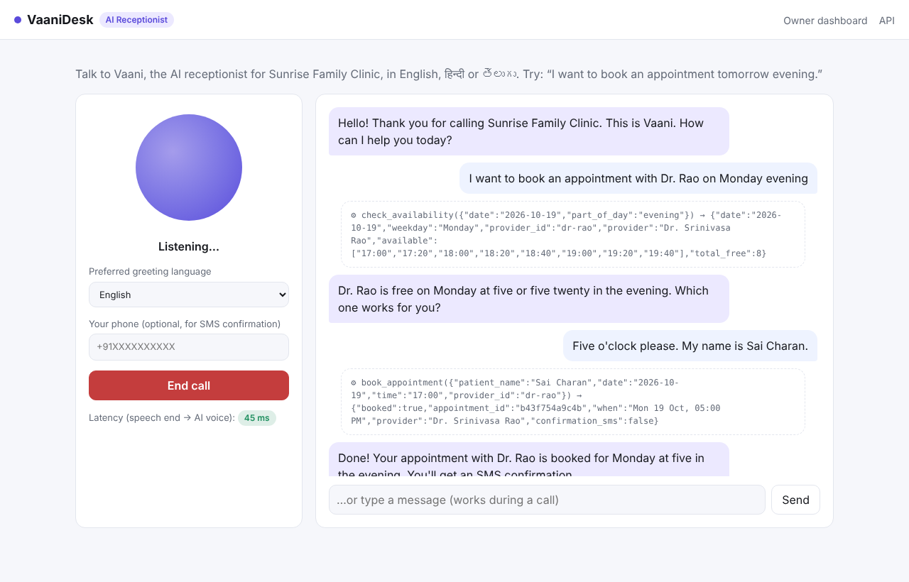
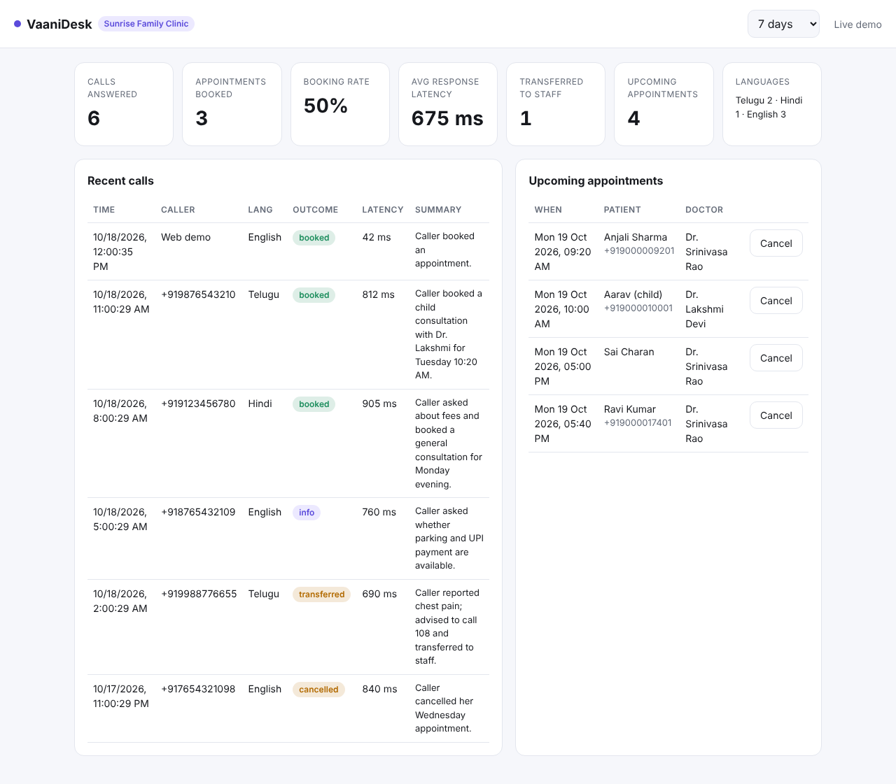
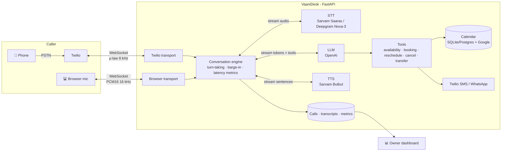

# VaaniDesk: Real-Time Multilingual Voice AI Receptionist

> An AI receptionist that **answers real phone calls** in **English, Hindi and Telugu**, books appointments, sends SMS confirmations and hands off to a human when needed. It's built for clinics and small businesses in India that miss calls during busy hours.


**Live demo:** `https://<your-deployment>/demo` · **Call it:** `+1 XXX XXX XXXX` *(replace once deployed)*

<!-- Replace with a 30-second GIF/video of a real call once your keys are set up -->
| Live voice demo | Owner dashboard |
|---|---|
|  |  |

<sub>Screenshots come from the test harness with mocked AI providers and sample data. The latency values shown are not real measurements.</sub>

---

## The problem

Small clinics, salons and restaurants miss many calls when the front desk is busy or closed. Every missed call can be a lost customer. A full-time receptionist is expensive, and "press 1 for…" IVR menus frustrate callers and rarely support Indian languages.

## The solution

VaaniDesk picks up the call and talks like a human receptionist:

```
Caller (Telugu): "రేపు సాయంత్రం డాక్టర్ అపాయింట్‌మెంట్ కావాలి"   (I need a doctor's appointment tomorrow evening)
VaaniDesk:        checks calendar → "డాక్టర్ రావు గారు 5:00 లేదా 5:20 కి ఖాళీగా ఉన్నారు. ఏది సరిపోతుంది?"
Caller:           "5 గంటలకి. నా పేరు సాయి."
VaaniDesk:        books slot → sends SMS/WhatsApp confirmation → logs the call for the owner
```

## Features

- 📞 **Real phone calls** through Twilio Media Streams (bidirectional 8 kHz μ-law audio over WebSocket)
- 🌐 **Browser voice demo** that anyone (including recruiters) can try with no phone
- 🗣️ **Multilingual:** English, Hindi and Telugu, including **mid-call language switching** and Telugu/Hindi-English code-mixing
- ⚡ **Streaming pipeline:** STT → LLM → TTS, each streamed, so speech starts as soon as the first sentence is ready
- ✋ **Barge-in:** the caller can interrupt; the agent stops talking immediately and listens
- 🛠️ **Agentic tool use:** check availability, book, find, reschedule or cancel appointments, transfer to a human, end the call
- 📚 **RAG over clinic documents:** answers fees, insurance, test-preparation and policy questions from the clinic's own PDFs and notes, using hybrid search (BM25 + embeddings, pgvector on Postgres), with the source shown on the dashboard
- 🔒 **Guardrails in the tools, not just the prompt:** callers can only see or change their own bookings (matched by phone), invalid numbers and placeholder names are rejected, and a change of mind moves the booking instead of double-booking
- 📅 **Clinic calendar with zero setup:** week view per doctor where staff block time (meetings, leave) and book walk-ins, plus a private **subscribe link** that shows bookings in Google, Apple or Outlook calendar on the owner's phone. Optional two-way **Google Calendar** sync.
- 💬 **SMS / WhatsApp confirmations** through Twilio
- 📊 **Owner dashboard:** calls, transcripts, AI call summaries, booking rate, per-turn latency, language mix
- 🧪 **Tested:** 42 automated tests, including protocol tests against mock Sarvam, Deepgram and OpenAI servers
- 🎯 **LLM evals:** multilingual conversation scenarios scored for tool use, outcome, reply language, brevity and safety
- 🔐 **Production touches:** Twilio webhook signature validation, dashboard auth, demo access code, concurrency limits, call watchdog, Docker and CI

## Architecture



**One caller turn, step by step**

1. Caller audio streams to STT continuously. VAD events detect when the caller starts and stops speaking.
2. On end-of-turn (silence plus a 350 ms grace period), the transcript goes to the LLM with the conversation history and tool schemas.
3. LLM tokens stream into a **sentence chunker**. Each finished sentence goes straight to streaming TTS, so the agent starts speaking before the LLM has finished.
4. When the LLM calls a tool (for example `check_availability`), VaaniDesk runs it, feeds the result back and keeps streaming.
5. The TTS voice language is chosen from the **script of each reply** (Telugu, Devanagari or Latin), so language switches are seamless.
6. If the caller speaks while the agent is talking, the response task is cancelled and Twilio's audio buffer is cleared (`clear` event). The model is told its reply was interrupted.
7. Latency from end of the caller's speech to the first audio byte is measured on every turn and shown on the dashboard.

More detail: [docs/architecture.md](docs/architecture.md).

## Tech stack

| Layer | Choice | Why |
|---|---|---|
| API / realtime | FastAPI, WebSockets, asyncio | One async process handles webhooks, media streams and the dashboard |
| Telephony | Twilio Programmable Voice + Media Streams | Real phone numbers, bidirectional audio, SMS/WhatsApp |
| Speech-to-text | Sarvam Saaras v4 (default), Deepgram Nova-3 | Sarvam auto-detects 22 Indian languages; Deepgram is a low-latency alternative |
| LLM | OpenAI (`gpt-4.1-mini` by default) | Fast streaming with reliable tool calling |
| Text-to-speech | Sarvam Bulbul v3 (streaming WebSocket) | Natural Indian English, Hindi and Telugu voices |
| Data | SQLAlchemy 2.0 async, SQLite or PostgreSQL | Zero setup locally, Postgres in production |
| Quality | Pytest, mock provider servers, LLM eval harness, Ruff, GitHub Actions | |
| Deploy | Docker, docker-compose (app + Postgres) | |

## Quickstart (browser demo, about 5 minutes)

```bash
git clone https://github.com/<your-username>/vaanidesk.git && cd vaanidesk
python -m venv .venv && source .venv/bin/activate      # Windows: .venv\Scripts\activate
pip install -r requirements-dev.txt
cp .env.example .env        # add OPENAI_API_KEY and SARVAM_API_KEY
uvicorn app.main:app --reload
```

Open **http://localhost:8000/demo**, click **Start call** and speak. The dashboard is at **http://localhost:8000/dashboard** (log in with `ADMIN_USER` / `ADMIN_PASSWORD` from `.env`).

> Without API keys the server still starts (dashboard, docs and tests work). `/health` lists which keys are missing.

### Get API keys

| Service | Where | Free tier |
|---|---|---|
| OpenAI | platform.openai.com → API keys | Pay-as-you-go |
| Sarvam AI | dashboard.sarvam.ai | Free credits on signup |
| Deepgram (optional) | console.deepgram.com | Free credits on signup |
| Twilio | twilio.com/try-twilio | Trial credit; a phone number costs about $1–2/month |

## Real phone calls (Twilio)

1. Expose your server over HTTPS. Locally: `ngrok http 8000`, then set `PUBLIC_BASE_URL=https://<id>.ngrok-free.app` in `.env`.
2. Buy a voice-capable number in the Twilio Console and add `TWILIO_ACCOUNT_SID`, `TWILIO_AUTH_TOKEN` and `TWILIO_PHONE_NUMBER` to `.env`.
3. In the Twilio Console, go to **Phone Numbers → your number → Voice → "A call comes in"** and choose **Webhook**, `POST`, `https://<your-domain>/twilio/voice`.
4. Call the number.

Trial accounts can only call and text **verified** numbers, and calls start with a short Twilio trial message. Upgrade the account to remove both. For an Indian caller experience, buy a number your audience can dial cheaply, or use Twilio's WhatsApp sandbox for confirmations.

## Adapting it to any business

Everything about the business lives in [`config/business.yaml`](config/business.yaml): name, opening hours, doctors or staff, services and prices, FAQ, policies, languages and the handoff number. Change it to a salon, restaurant or service centre and restart.

## Tests and evals

```bash
pytest -q                       # 98 tests, offline, about 15 s
python -m evals.run_evals       # multilingual LLM conversation evals (needs OPENAI_API_KEY)
python -m evals.run_evals -k telugu --repeat 3
```

The eval harness runs scripted callers ([`evals/scenarios.yaml`](evals/scenarios.yaml)) through the **real** conversation engine, LLM and tools, with audio replaced by text. It covers English, Hindi and Telugu bookings, Telugu-English code-mixing, FAQ, closed days, emergency transfer, refusing medical advice and cancellation. Each run is scored on tools called, outcome, reply script, reply length and banned content, and results go to `evals/results.json`.

**Results** (`gemini-3.5-flash-lite` via the OpenAI-compatible API, free tier, 18 Oct 2026):

| Scenarios | Pass rate | Median time to first spoken word | p90 | Median full turn (LLM + tools) |
|---|---|---|---|---|
| 10 (en / hi / te, code-mixing, emergency, safety, cancel) | **10 / 10** | **1.0 s** | 1.3 s | 1.9 s |

"Time to first spoken word" is what the caller waits for: when a tool is needed, VaaniDesk speaks a short filler ("One moment, please." / "जी, एक पल रुकिए।" / "ఒక్క క్షణం అండీ.") the moment the model asks for the tool, then answers when the tool returns. This cut the wait from about 1.9 s to 1.0 s. Lowering the model's thinking (`LLM_REASONING_EFFORT=minimal`) made no measurable difference with this model, so it is left at the default. Live calls add speech-to-text end-of-turn detection and the first chunk of text-to-speech on top of these numbers.

### Knowledge base (RAG)

Callers ask things a booking system can't answer: *"Do I need to fast before my sugar test?"*, *"Do you take cashless insurance?"*. VaaniDesk answers these from the clinic's own documents:

1. **Ingest:** files in [`knowledge/`](knowledge/) (and PDFs/notes uploaded on the dashboard's **Knowledge** page) are split into heading-sized chunks. Each chunk keeps its heading path, which becomes its citation (`lab-tests.md › Preparing for a test`). Unchanged files are never re-embedded.
2. **Retrieve:** the agent calls `search_clinic_knowledge` with the question rewritten in English. Search fuses **BM25 keywords** and **embedding similarity** with Reciprocal Rank Fusion. On Postgres the vector search runs in SQL with **pgvector**; locally it runs in NumPy. If embeddings are unavailable (no key, quota), it falls back to keywords, so answers never stop.
3. **Answer:** the agent answers only from the returned passages, in the caller's language, and says it isn't sure (offering staff) when the documents don't cover the question. Passages are treated as data, not instructions.
4. **Cite:** every lookup appears in the call transcript on the dashboard with its sources.

```bash
python -m evals.retrieval        # hit@1 / hit@3 / MRR for keyword vs vector vs hybrid, per language
```

**Results** (24 questions, `gemini-embedding-001`, 18 Oct 2026). Hit@1 = the right passage ranked first:

| Search | English | English, paraphrased | Hindi | Telugu | All hit@1 | All hit@3 | MRR |
|---|---|---|---|---|---|---|---|
| Keywords (BM25) | 100% | 57% | 0% | 0% | 54% | 58% | 0.56 |
| Vectors | 89% | 71% | 100% | 100% | 88% | 100% | 0.94 |
| **Hybrid (used)** | **100%** | 57% | **100%** | **100%** | **88%** | **100%** | **0.94** |

What this shows:

- **Keywords alone fail on other languages:** 0% for Hindi and Telugu questions, because they share no words with the English documents.
- **Multilingual embeddings fix that:** 100% for Hindi and Telugu, even before the agent translates the question.
- **The hybrid keeps keyword precision on exact English terms** (100%) while matching vectors overall.
- **The answer is always in the passages the agent reads:** hit@3 is 100% on every question. The three that miss rank 1 are paraphrases ("kids' doctor", "come to my house") whose answer is ranked second.

### Simulated callers + LLM judge

```bash
python -m evals.simulate        # LLM-played callers talk to the real agent; a judge LLM scores each call
```

Scripted evals only test what you thought of. [`evals/simulate.py`](evals/simulate.py) goes further: an LLM **plays a caller** from [`evals/personas.yaml`](evals/personas.yaml) (an impatient engineer, a Hindi caller who changes her mind, a Telugu-English-mixing mother, an elderly caller who gives a wrong number, a prompt-injection attacker, a parent pressing for medicine doses, a Telugu emergency, a Sunday-only customer, a cancellation) and holds a free-form conversation with the **real agent, tools and database**. Each call is then scored two ways:

- **Hard checks** on the database and tool log: which bookings exist afterwards (day, doctor, time, phone), which tools ran, and phrases the agent must never say (other patients' names, drug doses).
- **An LLM judge** with a rubric: task completion, correctness against tool results, language consistency, brevity and safety (1-5 each).

A call passes only if every hard check passes, the judge confirms success, and no score is below 3. The full transcripts and scores are written to [`evals/sim_report.md`](evals/sim_report.md). The judge can use a different model from the agent (`--judge-model`) to avoid a model grading itself, and requests are paced (`--rpm`) to fit free-tier rate limits.

<!-- SIM_RESULTS -->

## Deployment

**Step-by-step guide:** [docs/GO_LIVE.md](docs/GO_LIVE.md) covers Google Calendar sync, a one-click Render deploy (`render.yaml`) and a Twilio phone number.

```bash
docker compose up --build       # app + Postgres on :8000
```

Any Docker host with WebSocket support works (Render, Railway, Fly.io, AWS ECS or a VM). Set the environment variables from `.env.example`, point `PUBLIC_BASE_URL` at the public HTTPS URL, and update the Twilio webhook. Set `DEMO_ACCESS_CODE` before sharing a public demo link so strangers can't spend your API credits.

## Project structure

```
app/
  main.py                 FastAPI app, routes, startup
  config.py               settings (.env)
  business.py             business profile, opening hours → slots
  db.py                   SQLAlchemy models (calls, turns, appointments)
  audio.py                μ-law codec, resampling, WAV parsing (numpy)
  pipeline/
    session.py            real-time conversation engine (turn-taking, barge-in, tools, metrics)
    text.py               streaming sentence chunker, script-based language detection
    prompts.py            system prompt and multilingual greetings
  providers/              STT / LLM / TTS behind small interfaces (swappable)
  tools/                  calendar, agent tools, Twilio REST client
  transports/             Twilio media stream and browser WebSocket
  api/dashboard.py        owner dashboard API
static/                   browser demo (AudioWorklet mic capture) and dashboard
evals/                    LLM conversation eval harness and scenarios
tests/                    unit, engine, API and provider-protocol tests
```

## Roadmap

- [ ] Call recordings with consent message
- [ ] Reminder calls and SMS the day before appointments
- [ ] More languages (Tamil, Kannada); Sarvam already supports them
- [ ] Self-hosted STT/TTS option for lower cost
- [ ] Multi-tenant: one deployment serving many businesses

## License

MIT © Sai Charan Bhimavarapu
